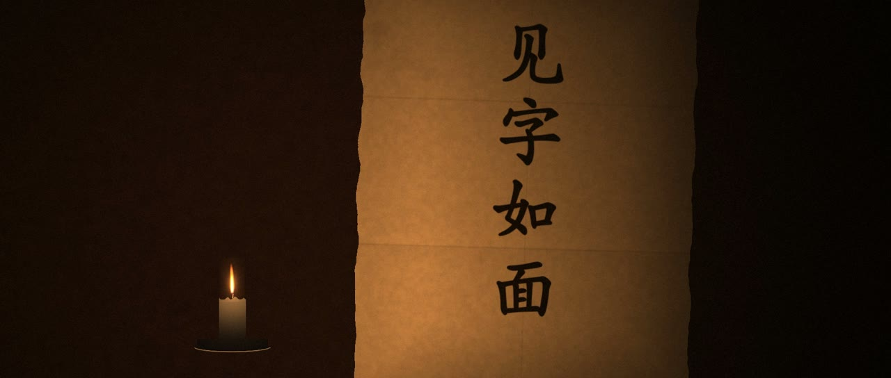
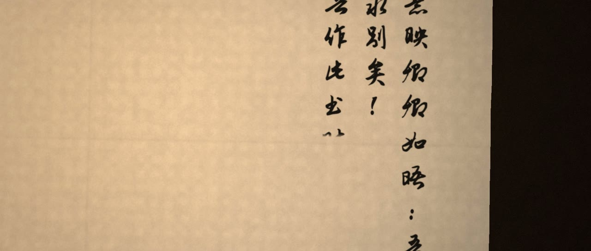
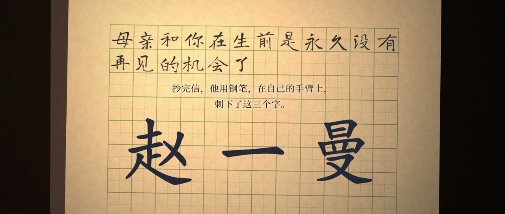
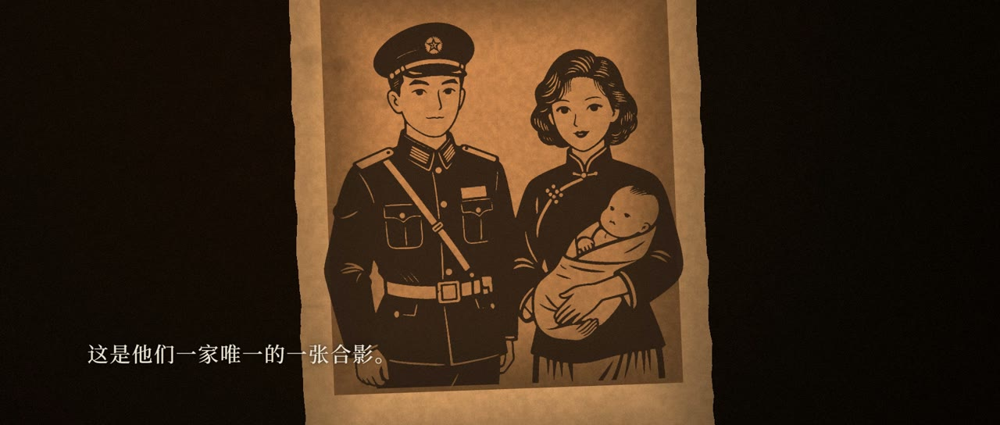
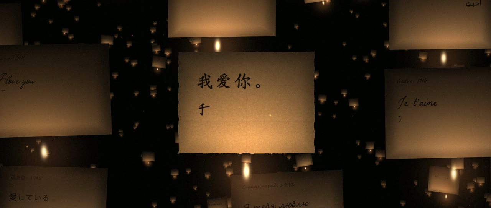
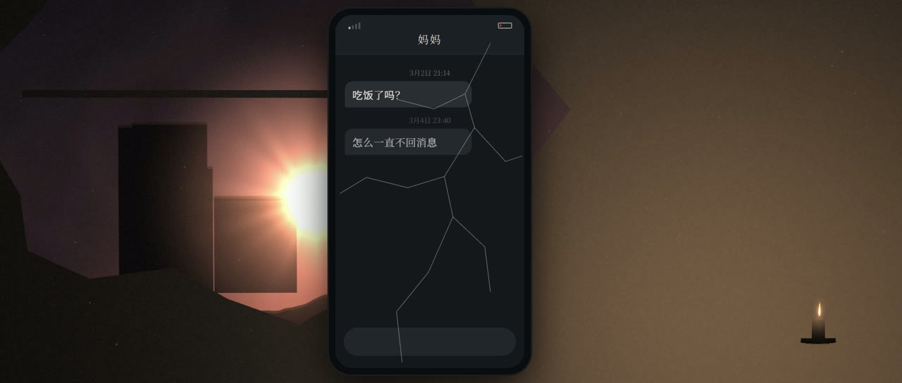

# 家书 · LETTERS HOME

一部约 13 分钟的反战短片，讲述五封真实的家书。片中的画面没有拍摄，也不是视频模型生成的：整个“纸雕灯”世界由代码在 WebGL 里搭建，层层剪纸被一盏灯照亮，镜头在纸层之间穿行。信是纸做的，人是纸剪的，家园是纸叠的；战争，是火。

*A 13-minute anti-war short built entirely in code from five real letters home. English summary [below](#english).*

<p align="center">
  
  
  
  
  
  
</p>

## 影片

**见字如面。** 旧时书信的开头语：看见我的字，就像看见我的人。对这五个家庭来说，这些字就是最后一面。

| | 写信人 | 年份 | 讲法 |
|---|---|---|---|
| 序 | 杜甫《春望》 | 757 | 长安城破，“家书抵万金” |
| 第一封 · 永不消亡 | 沙利文·巴卢 → 妻子萨拉 | 1861 | 风：声音先到，字被风吹向远方的窗 |
| 第二封 · 纸短情长 | 林觉民《与妻书》 | 1911 | 墨：一方手帕就是整个舞台 |
| 第三封 · 直到最后一刻 | 亨利·弗洛克 | 1914 | 剖面与时钟：先宣判，再倒数 |
| 第四封 · 赶快成人 | 赵一曼 → 儿子宁儿 | 1936 | 习字本：倒叙，从儿子抄信开始 |
| 第五封 · 念念 | 左权 → 妻子刘志兰 | 1942 | 从收信人那一边讲 |
| 尾声 | — | 今天 | 灯还亮着；不同国家的人写下同样的话；一部手机 |

完整剧本与视觉规范见 [`film/SCRIPT.md`](film/SCRIPT.md)、[`film/SPEC.md`](film/SPEC.md)。所有信件原文均已进入公有领域。

## 怎么做的

- **画面**：[three.js](https://threejs.org) 写的“纸雕剧场”引擎（[`film/lib/world.js`](film/lib/world.js)）：纸层、背光与边缘光、雾、天空与烟的着色器、粒子、调色与胶片颗粒、烧穿转场。每个镜头是一个构建函数（`film/lib/shots_*.js`）。
- **成片**：[HyperFrames](https://hyperframes.heygen.com)（HTML 渲染为视频）。时间线由脚本根据配音长度自动排布。
- **手写**：开篇“见字如面”、“赵一曼”和尾声的中文信按真实笔顺一笔一画写出（Make Me a Hanzi 笔顺数据）；其余书信用各自的手写字体逐字显现，每位写信人有自己的笔迹。
- **配音**：本地运行 [Qwen3-TTS](https://huggingface.co/Qwen/Qwen3-TTS-12Hz-1.7B-VoiceDesign) VoiceDesign，每封信一口气读完以保持同一个声音，再用 Whisper 按句切分并校对。
- **人物剪影**：本地 ComfyUI + Z-Image Turbo 生成黑白剪影，再自动抠成纸片。
- **声音**：音乐为公有领域录音；大部分音效由代码合成。

## 目录

```
film/                    HyperFrames 工程（成片就在这里渲染）
  index.html             主合成（由 gen_html.py 生成）
  compositions/          字卡、字幕、手机界面等子合成（生成）
  timeline.json          全片时间线（由 build_film.py 生成）
  dev.html               单镜头开发页：dev.html?shot=<id>&t=<秒>
  lib/                   WebGL 引擎与全部镜头
  assets/sil/            人物剪影（透明 PNG）
  assets/audio/vo/       处理好的配音
  assets/audio/sfx/      音效
  assets/audio/music/    音乐（不入库，见下方 fetch_assets）
  assets/fonts/          字体子集（woff2）；src/ 为完整字体（不入库）
  SCRIPT.md SPEC.md      剧本、视觉规范
work/
  tools/                 全部流程脚本（见下表）
  voices.json            每位写信人的台词与声音设计
  silhouettes.json …     剪影的提示词（assets*.json、sil_fix.json 为补充与修正）
  workflows/             ComfyUI 工作流
  edl.json               声音与字卡的剪辑表（生成）
licenses/                随附第三方文件的许可证文本
CREDITS.md               音乐、音效、字体、数据、模型的来源与许可
```

| 脚本 `work/tools/` | 作用 |
|---|---|
| `build_film.py` | 总剪辑：按配音长度排布全片镜头、字卡、字幕、声音 → `film/timeline.json`、`work/edl.json` |
| `gen_html.py` | 生成 HyperFrames 文件（index.html、compositions），并给中文字体做子集 |
| `mixdown.py` | 按剪辑表混音，母带到 −16 LUFS → `work/final_mix.wav` |
| `fetch_assets.py` | 下载音乐（并做响度处理）、完整字体、音效原始录音 |
| `tts_emotive_passage.py` | 当前使用的配音方式：整封信一口气读出（带每句的情绪指示），再切句 |
| `tts_passage.py` `tts_emotive.py` `tts.py` | 其他配音方式（整段 / 逐句） |
| `split_align.py` | 用 Whisper 的时间戳把整段配音切成句子 |
| `vo_qa.py` `reselect_emotive.py` | 配音质检（转写、音高、语速）与择优 |
| `process_vo.py` | 配音的修剪、空间感与响度 → `film/assets/audio/vo/` |
| `comfy_gen.py` `cutout.py` | 剪影生成（ComfyUI API）与抠图 |
| `sfx_synth.py` `sfx_chuff.py` | 合成音效 |
| `commons_audio.py` | 在 Wikimedia Commons 检索音频并查看许可 |
| `sheet.py` `grab.mjs` | 制作联系表、截取开发页的高清帧 |
| `legacy/` | 制作过程中的一次性脚本，仅作记录 |

## 渲染成片

需要：Node.js 22+、Chrome、[ffmpeg](https://ffmpeg.org)、Python 3.11+（`pip install -r requirements.txt`）。

```bash
python work/tools/fetch_assets.py music
```

```bash
cd film && npx --yes hyperframes@0.8.214 render -f 24 -q delivery -w 3 --browser-gpu -o renders/letters_home.mp4
```

```bash
python work/tools/mixdown.py
```

```bash
ffmpeg -i film/renders/letters_home.mp4 -i work/final_mix.wav -map 0:v -map 1:a -c:v copy -c:a aac -b:a 320k -shortest -movflags +faststart letters_home.mp4
```

渲染器自带的音轨只是预览用；最后一步换上母带混音。

预览（WebGL，可拖动时间线）：

```bash
cd film && npx --yes hyperframes@0.8.214 preview
```

开发单个镜头：在 `film/` 下启动任意静态服务器（如 `python -m http.server 8777`），打开 `http://127.0.0.1:8777/dev.html?shot=e_words&t=6`；镜头 id 见 [`film/lib/catalog.js`](film/lib/catalog.js)。

## 修改后重新生成

改台词、镜头时长或字卡后：

```bash
python work/tools/build_film.py
```

```bash
python work/tools/gen_html.py
```

`gen_html.py` 需要完整字体（`python work/tools/fetch_assets.py fonts`）。

重新配音（需要约 8 GB 显存，模型放在 `work/models/`）：

```bash
hf download Qwen/Qwen3-TTS-12Hz-1.7B-VoiceDesign --local-dir work/models/Qwen3-TTS-12Hz-1.7B-VoiceDesign
```

```bash
python work/tools/tts_emotive_passage.py lin dufu
```

然后用 `split_align.py` 切句、`vo_qa.py` 校对、`process_vo.py` 处理，再运行 `build_film.py` 与 `gen_html.py`。

重新生成剪影需要本地 ComfyUI 与 Z-Image Turbo 模型（`COMFY_HOST` 环境变量指向 ComfyUI，默认 `http://127.0.0.1:8189`）：

```bash
python work/tools/comfy_gen.py work/silhouettes.json work/sil_raw
```

```bash
python work/tools/cutout.py work/sil_raw film/assets/sil
```

## 已知限制

- 尾声“同样的话”一场用到 Windows 自带字体（Segoe Script、Malgun Gothic、Nirmala UI 等）书写多国文字；在其他系统上会由系统字体替代。
- 渲染需要 GPU 加速的 Chrome；全片约 15 分钟（RTX 级显卡）。
- 配音与剪影的生成依赖本地模型，结果不是逐位可复现的；仓库里已经带有成片所用的配音与剪影。

## 许可

本项目的代码与文本以 [MIT 许可证](LICENSE) 发布。第三方素材（音乐、音效、字体、笔顺数据、three.js）保留各自的许可，来源和许可见 [CREDITS.md](CREDITS.md)，随附的许可证文本在 [`licenses/`](licenses/)。

---

<a id="english"></a>
## English

**Letters Home** is a 13-minute anti-war short film made from five real, public-domain letters written home from war — Sullivan Ballou (1861), Lin Juemin (1911), Henri Floch (1914), Zhao Yiman (1936) and Zuo Quan (1942) — opened by Du Fu's poem *Spring View* (757). Nothing is filmed or video-generated: every scene is a layered paper-cut world built in WebGL with three.js and rendered to video with [HyperFrames](https://hyperframes.heygen.com). Voices are generated locally with Qwen3-TTS, figure silhouettes with Z-Image Turbo, and the music is public-domain recordings from Wikimedia Commons.

- Render the film: fetch the music (`python work/tools/fetch_assets.py music`), render with `npx hyperframes render` in `film/`, mix with `python work/tools/mixdown.py`, then mux with ffmpeg (commands above).
- Change the edit: `work/tools/build_film.py` → `work/tools/gen_html.py`.
- Licence: the project's code and text are [MIT](LICENSE); third-party material keeps its own licence — sources and licences in [CREDITS.md](CREDITS.md).
